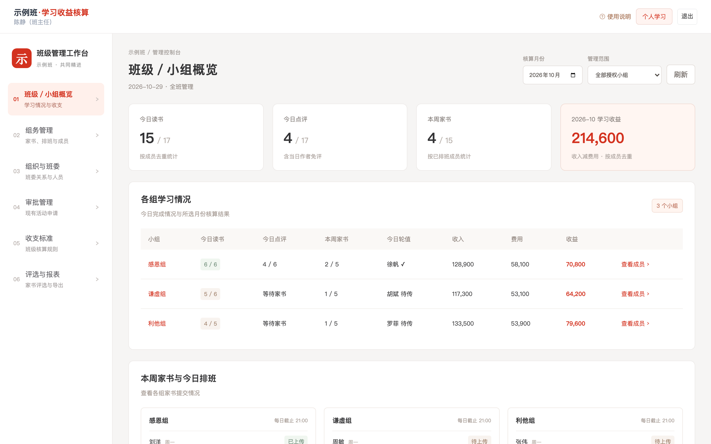

# gratitude-ledger · 班级学习收益核算系统

一个给盛和塾式学习小组用的打卡、家书与积分应用：每天读书打卡、每周轮值写家书并互相点评、登记周会和大课、按班级自己的收支标准核算"学习收益"，并支持班委在 PC 控制台做组织管理、审批与月度报表。

后端是一个**零运行时依赖**的 Node 18 单文件服务，数据存在一个 JSON 文件里；前端是 Vue 3 + Vant 4，构建产物已提交到 `public/`，服务端直接托管。每个班级部署一份自己的实例，数据互不相通。

> 本项目采用 MIT 协议开源。仓库内**不包含任何真实学员数据**，部署者需自行负责所辖数据的合规、备份与访问控制。

## 功能一览

| 模块 | 能力 |
| --- | --- |
| 登录 | 选择小组 → 选择姓名 → 输入登录码；管理员可在组织页管理账号 |
| 每日打卡 | 每日读书打卡、点评家书、周会 / 月度学习会 / 线上视频 / 线下大课登记 |
| 家书轮值 | 每人每周一篇；按小组排班表轮值；可代未上传的组员传；登记日期优先取正文【分享时间】；迟交标记 |
| 家书互评 | 阅读当日轮值家书并点评，作者可回复；当日轮值作者免评 |
| 积分核算 | 每个学习项目有收入 / 费用 / 工时，自动算"学习收益"，支持全组奖励与未全员补救 |
| 大项申请 | 利他分享、企业走访、发展塾友、创新等需审批的大项在线提交 |
| 排行与荣誉 | 月度排行、小组排行、每日班级优秀家书与塾里优秀、优秀家书库 |
| 管理控制台 | 班级 / 小组概览、组务管理（家书排班与成员）、组织与班委、审批、收支标准、评选与报表（CSV 导出） |
| 首次初始化 | 全新实例打开首页即进入初始化向导，填班级名、班主任、登录码和分组即可使用 |
| 移动端 | H5 页面适配手机浏览器；有管理权限的账号在 PC 上使用独立控制台布局 |

## 界面预览

PC 管理控制台：



手机端 H5：


> 截图为仓库自带演示数据（`node tools/seed-demo.js` 生成，人名与内容全部虚构）。

## 快速开始

要求：**Node.js 18 或更高版本**。不需要 `npm install`，后端没有任何第三方依赖。

```bash
git clone https://github.com/chenwlhahaha/gratitude-ledger.git
cd gratitude-ledger
node server.js
```

然后打开 <http://127.0.0.1:3104>：

1. 首次访问会进入初始化页面，填写班级名称、班主任姓名、登录码（即班主任账号的登录码，也可作为全班统一入口码），以及最初的小组名称。
2. 初始化成功后会自动以班主任身份登录；通过底部导航的「控制台」进入管理后台。
3. 在「组务管理」里添加组员、设置家书排班，在「组织与班委」建小组、任命班委，在「收支标准」里按本班规则调整分值。

数据默认写入 `./data/store.json`，家书图片写入 `./data/uploads/`。想换位置就设置 `DATA_DIR`：

```bash
DATA_DIR=/var/lib/gratitude-ledger PORT=3104 node server.js
```

## 部署与运维

- [部署指南](docs/deploy.md)：Linux 单机 + systemd、Nginx / Caddy 反向代理与 HTTPS、环境变量、升级与回滚。
- [管理员使用指南](docs/setup.md)：初始化、建组、加成员、任命班委、设置收支标准与家书排班、月度导出。
- [备份与恢复](docs/backup.md)：`store.json` 与 `uploads/` 的备份、恢复和迁移到新机器。
- [架构说明](docs/architecture.md)：进程结构、数据结构、`schemaV2` 迁移机制、权限模型与 API 分组。

生产环境请至少做到：使用 HTTPS、把 `DATA_DIR` 放在仓库目录之外、设置非弱口令的登录码、配置定期备份。

## 目录结构

```text
.
├── server.js              # 零依赖 Node 服务：API + 静态托管 + JSON 存储
├── public/                # 前端构建产物（已提交，服务端直接托管）
├── frontend/              # Vue 3 + Vite + Vant 4 源码
│   ├── src/
│   │   ├── views/         # 登录、今日、家书、小组、我的、管理控制台、初始化
│   │   └── components/    # 首次使用指引、优秀家书等
│   └── vite.config.js     # 构建输出到 ../public，开发时 /api 代理到 3104
├── tools/                 # 集成测试与浏览器冒烟脚本（合成数据）
├── docs/                  # 部署、使用、备份、架构文档
└── .github/               # CI、Issue 与 PR 模板
```

## 开发与测试

后端改动后，直接跑合成数据集成测试（临时目录 + 临时端口，不读写真实 `data/`）：

```bash
node tools/console-tests.js
node tools/honors-tests.js
```

改前端时：

```bash
cd frontend
npm ci
npm run dev      # 开发服务器，/api 代理到 127.0.0.1:3104
npm run build    # 构建到 ../public
```

`tools/ui-smoke.cjs` 与 `tools/counselor-ui-smoke.cjs` 需要本机安装 Chrome / Playwright，属于可选的本地冒烟测试，CI 不执行。

## 数据与隐私

- 仓库内只有合成测试数据（`tools/*-tests.js`），**没有任何真实班级、学员或家书内容**。
- 部署后的数据完全归部署者所有，保存在自己的 `DATA_DIR` 中；本项目不上传、不回传任何数据。
- 家书可能包含个人成长经历等敏感内容，请限制服务器访问范围、使用 HTTPS，并只授予班委必要的管理权限。
- 备份文件同样是敏感数据，请按机构要求加密存放并设置保留期限。

## 参与贡献

欢迎提交 Issue 与 Pull Request。开始之前请阅读 [贡献指南](CONTRIBUTING.md)、[行为准则](CODE_OF_CONDUCT.md) 和 [安全策略](SECURITY.md)。安全问题请走私密渠道报告，不要公开提交 Issue。

## License

[MIT](LICENSE) © gratitude-ledger contributors
