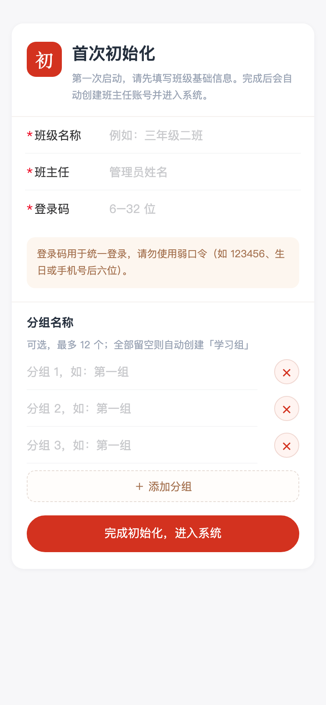

# 班级管理员使用指南

本文按"刚开始用"到"每月收尾"的顺序，讲清楚初始化、组织搭建、日常规则配置和报表导出。界面以 PC 管理控制台为主，手机端 H5 用于学员日常打卡与写家书。

## 1. 初始化（只做一次）

全新实例没有 `data/store.json` 时，打开首页会直接进入初始化页面，需要填写：

| 字段 | 说明 |
| --- | --- |
| 班级名称 | 显示在登录页和控制台顶部，例如"示例班" |
| 班主任姓名 | 创建为第一个管理员账号，拥有全班管理权限 |
| 登录码 | 班主任账号的登录码，也是成员的统一入口码；6～32 位，建议 8 位以上、非弱口令，不要与其他班级复用 |
| 分组名称 | 初始小组名，默认给 3 行，可增删；最多 12 个；留空会自动创建一个"学习组" |

提交后会直接以班主任身份登录。初始化只能执行一次，完成后再次提交初始化会提示「已完成初始化」。

> 初始化完成后请立刻确认：能在「组织与班委」看到自己，且能进入管理控制台。若登录码填错，可在控制台重置（见 2.4）。

## 2. 搭建组织

### 2.1 建小组

进入 **管理控制台 → 组织与班委 → 各组班委**，在底部"新建小组"填写组名并创建。

### 2.2 加成员

进入 **组务管理**，先用顶部下拉框选择目标小组，再在「添加组员」里填写：

- 姓名：学员在本班使用的称呼，登录时按姓名选择；
- 登录码：可与全班统一码相同，也可单独设置；
- 月收入目标：用于"目标完成率"，每月核算时对比实际收入。

新成员默认角色是组员，创建后会出现在对应小组的家书排班候选里。成员离职或暂不参与时用"停用账号"，不要删除，历史记录会保留。

### 2.3 任命班委

班委分两层，都在 **组织与班委** 里任命：

**班级班委**（统筹各组同名委员）

| 职务 | 主要权限 |
| --- | --- |
| 班主任 | 全班管理：组织、审批、收支标准、报表、评选 |
| 副班主任 | 与班主任同级（角色同为管理员） |
| 班长 | 与班主任同级，可管理全班 |
| 班级学委 | 查看/导出学习范围、登记"塾里优秀家书" |
| 班级纪委 / 关爱委 / 活动委 | 查看本班组织情况，按条线管理各组同名委员 |

**各组班委**（每组可分别设置）

| 职务 | 说明 |
| --- | --- |
| 组长 | 管理本组组务：家书排班、组内加分、添加组员 |
| 辅导员 | 辅导负责组；学习任务归属自己的"辅导员组"，可跨组查看 |
| 学委 | 查看本组学习情况与报表 |
| 纪委 / 关爱委 / 活动委 | 查看本组组织情况 |

任命时选择成员即可，同一人可以同时担任多个职务。辅导员的人事关系留在所属小组，学习任务（打卡、家书）记在辅导员组，避免跨组数据混乱。

### 2.4 管理账号

进入 **组织与班委 → 成员名单**，对已有成员执行：

- **停用 / 启用**：停用后不能登录，不计入在册人数；
- **重置登录码**：成员忘记登录码时使用；
- **调整任务组**：一般只用于辅导员等跨组场景。

管理员不能停用其他管理员账号，避免误操作把全班锁死。

## 3. 设置收支标准

进入 **管理控制台 → 收支标准**，每个学习项目可配置：

| 字段 | 含义 |
| --- | --- |
| 收入 | 完成一次计入的"学习收入" |
| 费用 | 完成一次计入的"学习费用"（时间/精力成本） |
| 工时 | 计入的投入工时（小时） |
| 全组奖励 | 全组按时完成时给每个人的额外加分 |
| 未全员补救 | 有人未完成时给每个人的扣分（负值） |

默认项目包括每日读书打卡、点评当日家书、每周周会、月度学习会、线上视频学习、线下大课学习。分值按本班约定修改，保存后全班即时生效，**历史月份不会重算**，便于跨月对账。

大项（利他分享、企业走访、发展塾友、创新）走审批，不在收支标准里改；它们由服务端内置。

## 4. 家书轮值设置

进入 **组务管理**，先用顶部下拉框选择要管理的小组。

### 4.1 每周排班

在"家书排班"里，把成员安排到周一至周日，可以同一天安排多人；设置"每日截止"（默认 21:00）。

规则说明：

- **每人每周一篇**，同一人同一周不能重复上传；
- 排班决定"今天该谁写"，周期从建组当天起算；
- 当天作者**免点评**，其他成员点评其家书即完成当日点评项；
- 轮值者当天还没上传家书时，点评项不生效，避免"无家书可评"也算完成；
- 晚于自己的排班日（或排班日当天已过截止时间）上传会标记为**迟交**，不影响积分入账，但会显示在列表里。

### 4.2 代传

组员无法上传时，同组任一成员可以帮其"代传"：家书计在被代传人名下，列表里会标注代传人，代传不改变当周归属。代传对象必须是本任务组成员。

### 4.3 登记日期

家书归属日期优先取正文中的 **【分享时间】**（例如"【分享时间】10 月 8 日"；也识别"【时间】2026 年 10 月 8 日"）。只接受上传日前后合理范围内的日期（前 30 天至后 10 天），识别不到或超出范围时用上传当天。这样提前写、第二天补传都能记到正确日期。建议在班级群统一模板，减少补录沟通成本。

### 4.4 组内加分 / 扣分

"组内加分／扣分"用于临时调整（如活动额外贡献、迟到补救），计入提交当天。名目和备注写清楚，便于月底解释。

## 5. 审批与大项

学员在手机端提交大项申请后，进入 **管理控制台 → 审批管理**：

- **待处理**：固定金额项直接"通过"或"驳回"；非固定金额项（如创新）需要填写批准金额后再通过；
- **已通过 / 已驳回**：可回看申请说明和处理结果。

审批通过后金额计入申请当天。驳回不会产生任何积分，申请人可以在手机端重新提交。

## 6. 评选与报表

### 6.1 优秀家书

- **班级优秀家书**：班主任在"评选与报表 → 优秀家书评选"里阅读并设置；
- **塾里优秀家书**：由班级学委登记，只在工作日生效；
- 优秀家书会进入班级优秀家书库，学员可在手机端浏览。

历史"每周精选"已停用，旧数据保持原样，不会因新评选规则被改写。

### 6.2 评选加分

"评选加分"是给个人的一次性加分，计入当天，用于家书之外的表彰（如分享、担当）。名目建议固定几个常用词，方便月度汇总。

### 6.3 月度导出

在"月度统计导出"选择月份后：

- 班主任 / 班长可导出全班或指定小组；
- 组长、学委只能导出自己授权范围内的小组；
- 文件名形如 `2026-10.csv`，带 UTF-8 BOM，Excel 直接打开不乱码；
- 每个小组一段：成员 × 每日收益 + 收入 / 费用 / 收益 / 工时 / 目标完成率。

导出前先核对：成员是否都在册、任务组是否正确、当月审批是否处理完。导出后建议与上月对比，异常波动先查排班和补录。

## 7. 每月收尾清单

1. 处理完所有待审批申请；
2. 检查家书是否有人连续缺席，确认排班与代传记录；
3. 核对收支标准是否当月有调整（调整只影响之后）；
4. 评选班级 / 塾里优秀家书；
5. 导出 CSV 存档，并按 [备份文档](backup.md) 备份一次 `DATA_DIR`；
6. 在班级群公布本月收益与下月排班。

## 8. 常见问题

| 问题 | 处理 |
| --- | --- |
| 成员登录提示"姓名或登录码不正确" | 确认姓名与在册一致、账号未停用；管理员可重置登录码 |
| 学员说"打卡了但没加分" | 每日项目需在"今日"点击卡片完成，不是打开页面就算；大项需审批通过才入账 |
| 点评了却没算完成 | 只有点评"当日轮值者本周家书"才算；当天轮值作者本人免评 |
| 家书记到了错误日期 | 检查正文是否带规范【分享时间】；已发布的记录需要管理员在组务里做加减分修正 |
| 排行榜与导出数字不一致 | 导出按自然月汇总，排行按当前规则实时计算；先确认月份和授权范围一致 |
| 忘记管理员登录码 | 若还有其他管理员账号，用其重置；全部丢失需停服后按备份文档恢复到已知状态 |
